# HealthTrack

HealthTrack is an ASP.NET Core MVC application for recording personal health readings and appointments, with a doctor workspace for reviewing registered patients and their histories.

## Features

- Patient registration and role-aware patient/doctor sign-in.
- Patient dashboard with heart, diabetes, general checkup, and nutrition sections.
- Create, edit, and delete blood sugar, blood pressure/heart rate, and general checkup readings.
- Personal appointment records with an in-app appointment list.
- BMI, energy, and nutrition estimates based on profile and activity inputs.
- Doctor patient directory, patient classification, detailed histories, and summary reports.
- Responsive screens, keyboard-accessible account-type selection, validation feedback, and POST-based logout.

## Stack and layout

| Area | Technology |
| --- | --- |
| Application | ASP.NET Core MVC / .NET 8 |
| Rendering | Razor views, HTML, CSS, JavaScript; bundled Bootstrap/jQuery for shared pages |
| Persistence | SQL Server and Entity Framework Core 9.0.21 |
| Account security | ASP.NET Core PasswordHasher, server-side sessions, role filters, antiforgery validation |
| Tests | xUnit on .NET 8 |

```text
Controllers/       Account, doctor, patient, and public page actions
Data/              EF Core database context
Models/            Existing persisted entities and result models
ViewModels/        Validated form inputs and report models
Services/          Password hashing and explicit account-maintenance commands
Filters/           Role checks and safe database-error handling
Migrations/        SQL Server migration history
Views/             Razor pages
wwwroot/css/       Shared responsive styles and extracted page styles
.config/           Pinned dotnet-ef tool manifest
tests/             Security and migration regression tests
docs/              Audit notes and screenshots
```

The historical `HelthTrack` spelling remains in project/solution filenames and namespaces for compatibility. The displayed product name is HealthTrack.

## Prerequisites

- .NET 8 SDK (or a compatible newer SDK that supports targeting .NET 8).
- SQL Server, SQL Server Express, or SQL Server LocalDB on Windows.
- A database login with the permissions needed to apply migrations, or Windows integrated authentication.
- Git. Visual Studio 2022 is optional.

## Setup

```sh
git clone https://github.com/obadaburini/HealthTrack.git
cd HealthTrack
dotnet restore HelthTrack.sln
dotnet tool restore
```

The development connection defaults to the local SQL Server instance and `HealthTrackDb`, using Windows authentication. Set your own connection with ASP.NET Core user secrets (the project already defines a UserSecretsId). This example uses LocalDB and contains no password:

```sh
dotnet user-secrets set "ConnectionStrings:HealthTrack" "Server=(localdb)\MSSQLLocalDB;Database=HealthTrackDb;Trusted_Connection=True;TrustServerCertificate=True" --project HelthTrack.csproj
```

For deployment, supply `ConnectionStrings__HealthTrack` through the host's secret/environment configuration. Do not put database credentials into tracked appsettings files. Use a trusted SQL Server certificate in production; `TrustServerCertificate=True` is intended for local development. Configure `AllowedHosts` and HTTPS for the deployed host. The app does not load `.env` files.

## Database and migrations

Back up an existing database before applying migration changes. Confirm the selected connection points to the intended database.

```sh
dotnet ef migrations list --project HelthTrack.csproj
dotnet ef database update --project HelthTrack.csproj
dotnet ef migrations has-pending-model-changes --project HelthTrack.csproj
```

All 12 original migrations are retained. No new schema migration is required for these improvements. The last existing migration, `20260105132022_AddPatientTypeToPatient`, was repaired to avoid adding the `PatientType` column twice: the preceding migration already renames it from `Disease`. Its rollback leaves the column in place for the preceding migration to rename back. Existing applied migration IDs remain valid; the repair does not run again on databases already at that migration.

Migrations are explicit operator steps and do not run automatically when the website starts. Do not use `EnsureCreated` on a database managed by migrations. No database files, real account data, or demo accounts are included in this repository.

## Accounts and password upgrades

Patients can register through the website. Registration creates both legacy account/profile rows atomically and stores a salted ASP.NET Core password hash in both password columns. Passwords are never trimmed or printed.

Existing users can still sign in: a successful legacy login upgrades the plaintext password and its duplicate profile copy to a hash. To remove plaintext from all existing account rows before reopening the application, stop the web instance, back up the database, then run this explicit command using the intended connection:

```sh
dotnet run --project HelthTrack.csproj -- --maintenance=upgrade-passwords
```

The command is transactional and can be rerun. It does not reset users' passwords or create a schema migration. Accounts that have not signed in retain their legacy stored format until successful login or this explicit upgrade; schedule the bulk upgrade for an existing deployment.

There is no public doctor registration or default administrator password. An operator can create a doctor account with `--maintenance=create-doctor`. Supply `Bootstrap:Username` and `Bootstrap:Password` through user secrets or process environment variables, never through a URL or committed file. For example, PowerShell can prompt without displaying the password:

```powershell
$env:Bootstrap__Username = Read-Host 'Doctor username'
$doctorPassword = Read-Host 'Doctor password (12-128 characters)' -AsSecureString
$env:Bootstrap__Password = [System.Net.NetworkCredential]::new('', $doctorPassword).Password
try {
    dotnet run --project HelthTrack.csproj -- --maintenance=create-doctor
} finally {
    Remove-Item Env:Bootstrap__Username, Env:Bootstrap__Password
    Remove-Variable doctorPassword
}
```

Maintenance commands exit without starting the web server. Duplicate usernames are rejected; existing accounts are not overwritten. Remove any Bootstrap values from user secrets after provisioning.

## Run

```sh
dotnet dev-certs https --trust
dotnet run --project HelthTrack.csproj --launch-profile https
```

Open **https://localhost:7105**. The companion HTTP address is http://localhost:5122 and redirects to HTTPS. Select Patient or Doctor at sign-in. To use the HTTP-only launch profile for development, run `dotnet run --project HelthTrack.csproj --launch-profile http`; use HTTPS when working with account or health data.

If the database is unreachable, data actions return a safe service-unavailable page instead of exposing SQL details. Check the local connection, database service, and migration state. Missing connection configuration fails at startup with a configuration message.

## Validation

```sh
dotnet restore HelthTrack.sln
dotnet build HelthTrack.sln --no-restore
dotnet test HelthTrack.sln --no-build
dotnet list HelthTrack.csproj package --vulnerable --include-transitive
```

Tests cover salted password storage, legacy compatibility, malformed hashes, role-filter coverage, invalid registration, and the migration compatibility guard. See [the audit](docs/AUDIT.md) for full runtime and database validation results.

## Screenshots

Screenshots are captured locally using synthetic demo accounts and records in an isolated SQL Server LocalDB database. No real patient information or passwords are shown. Open an image for the full-size view.

| Sign in | Patient registration |
| --- | --- |
| 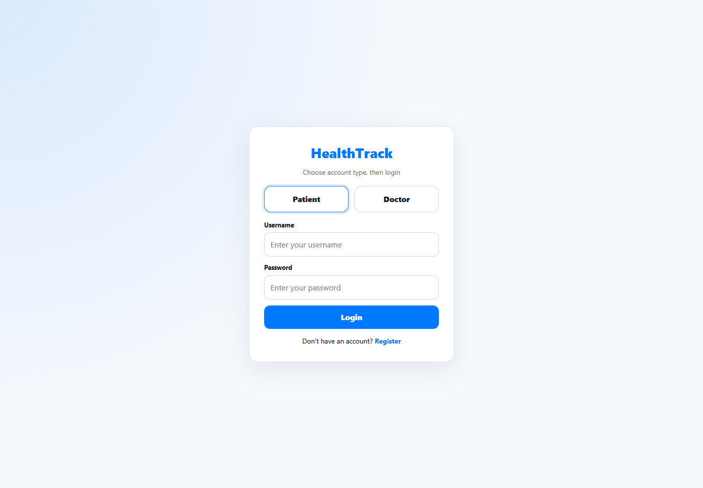 | 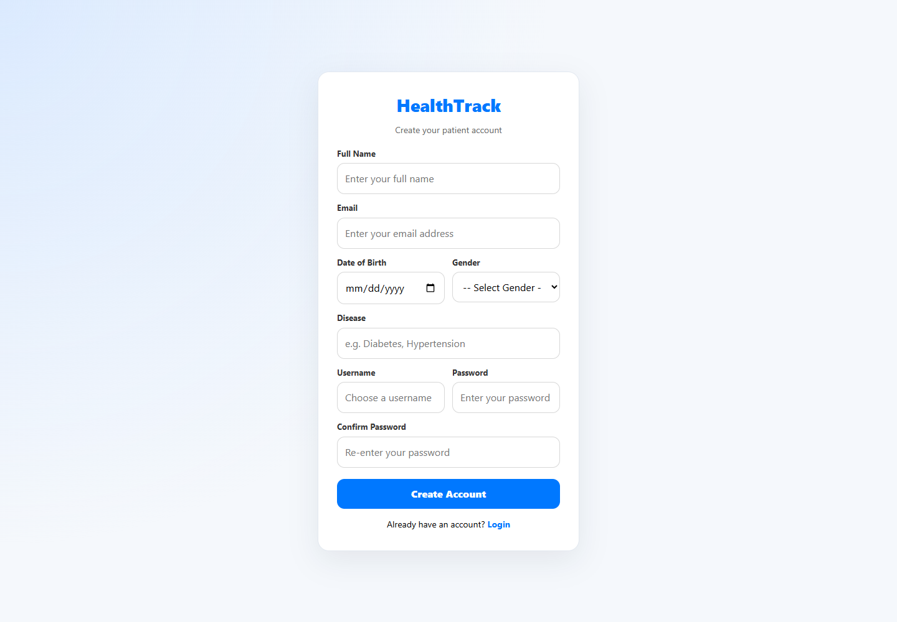 |

| Patient dashboard | Doctor dashboard |
| --- | --- |
| 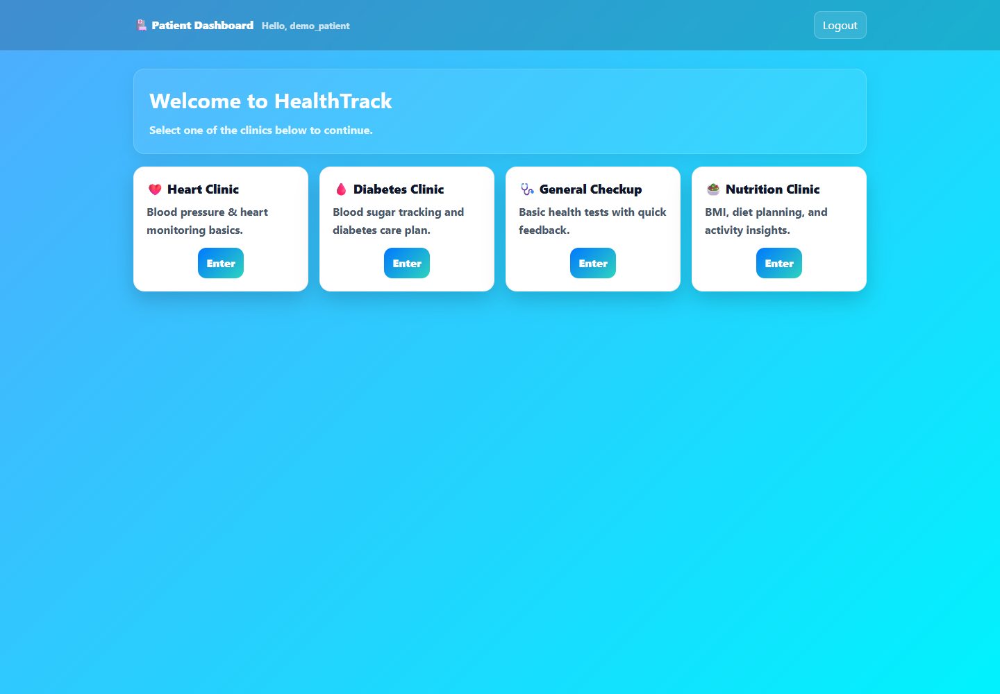 | 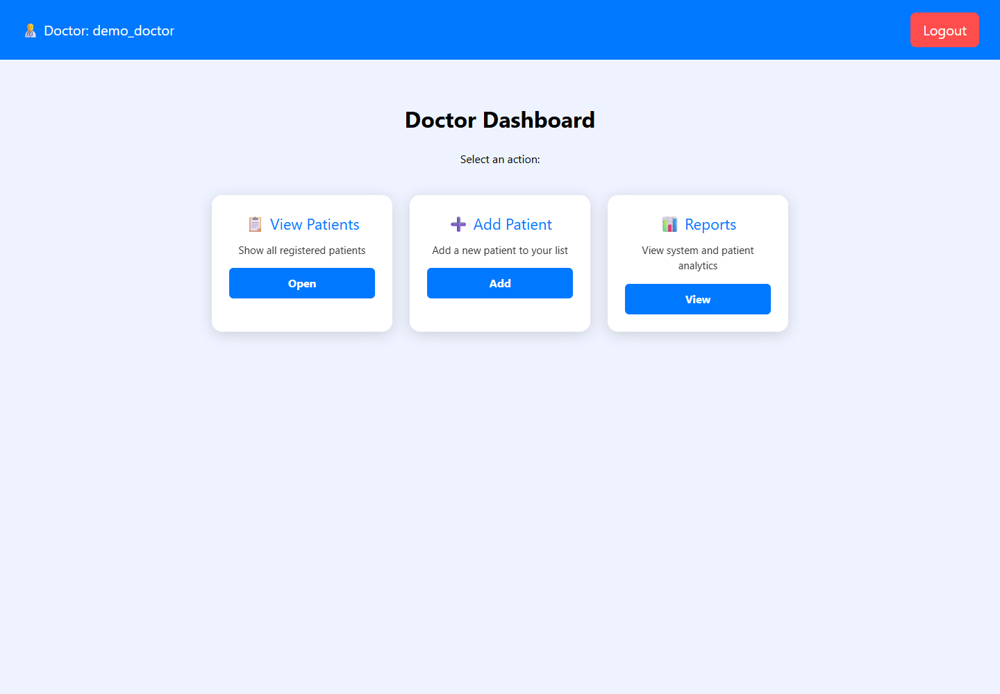 |

| Blood sugar | Heart vitals |
| --- | --- |
| 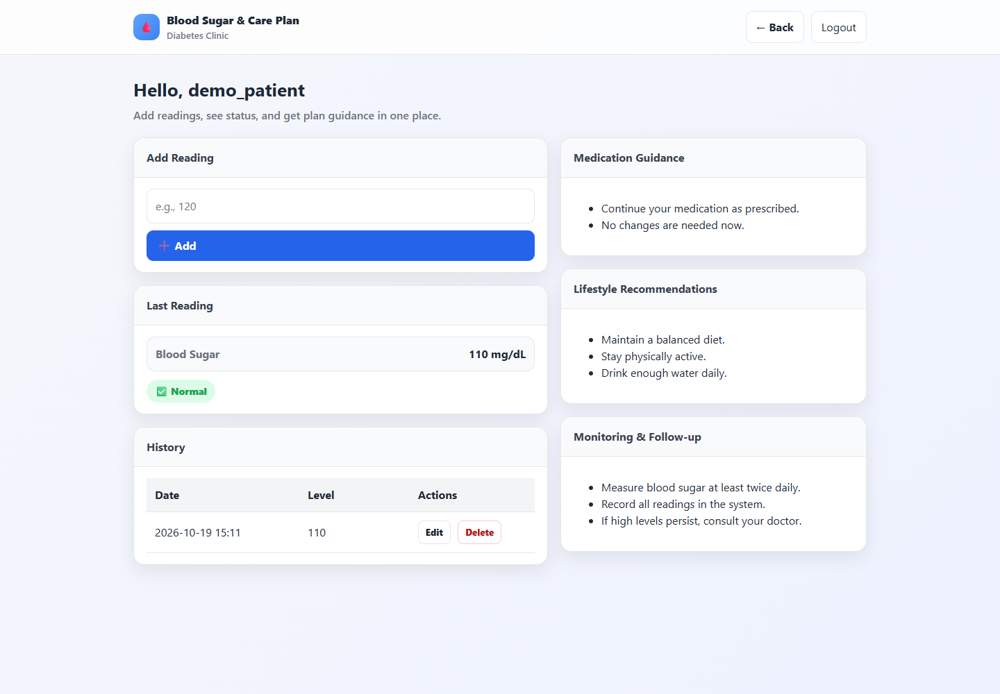 | 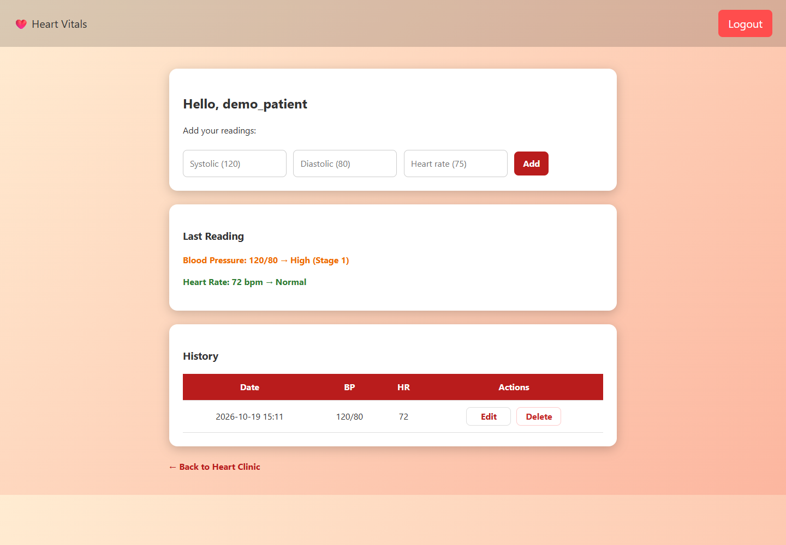 |

| General checkup | Appointments |
| --- | --- |
| 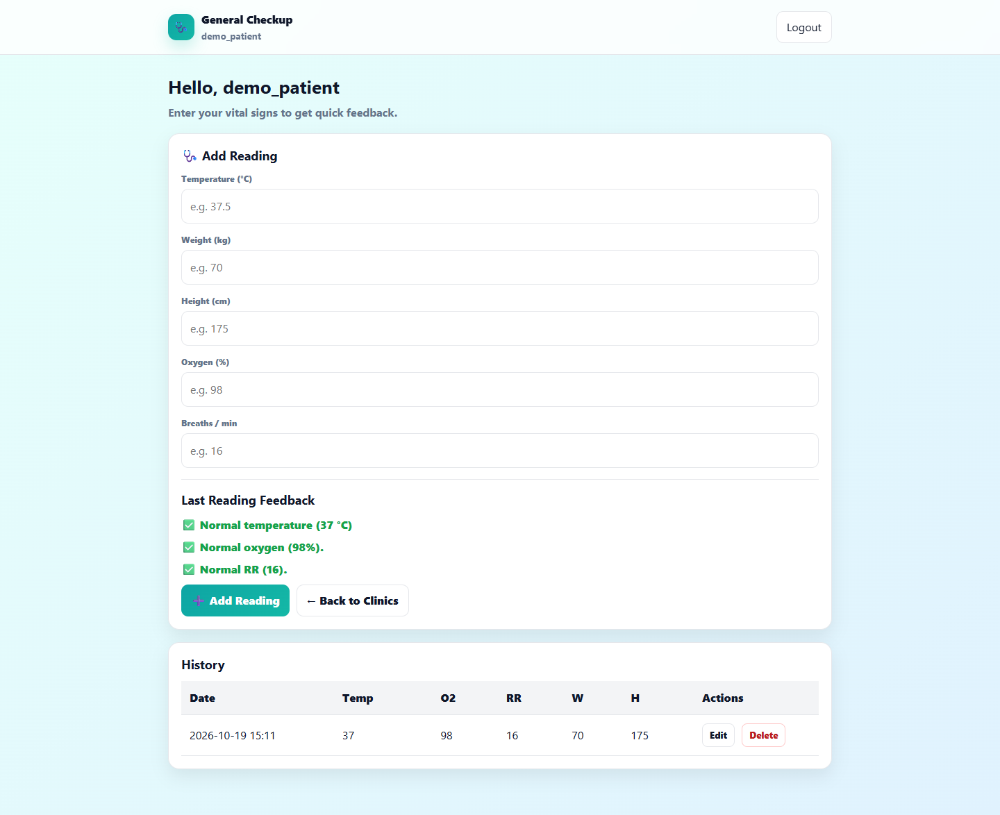 | 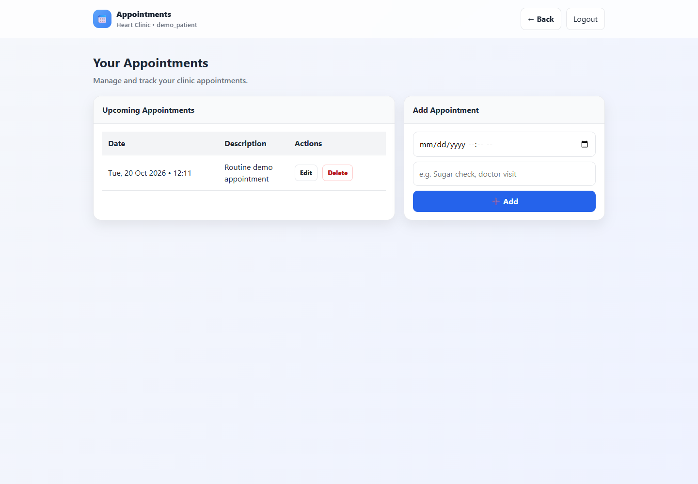 |

| Nutrition | Patient directory |
| --- | --- |
| 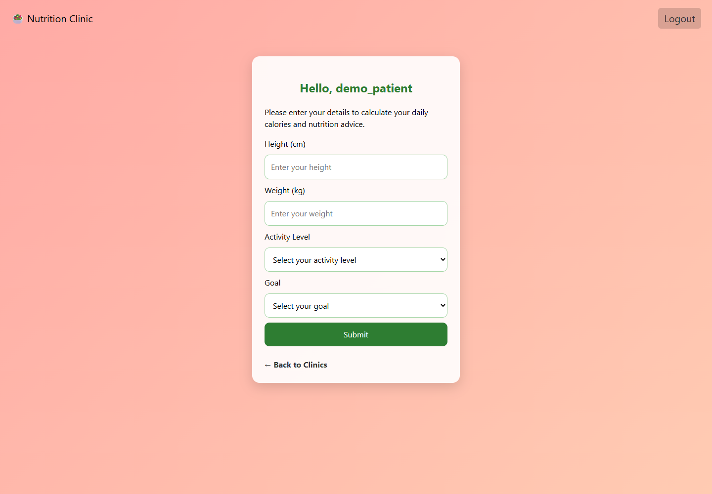 | 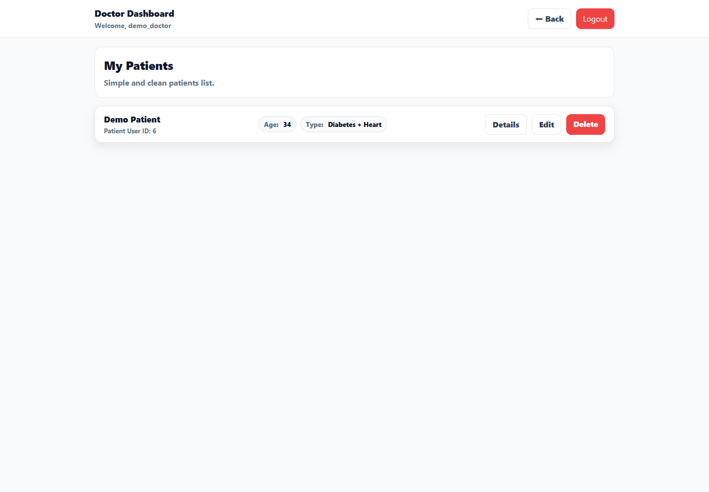 |

| Patient details | Reports |
| --- | --- |
| 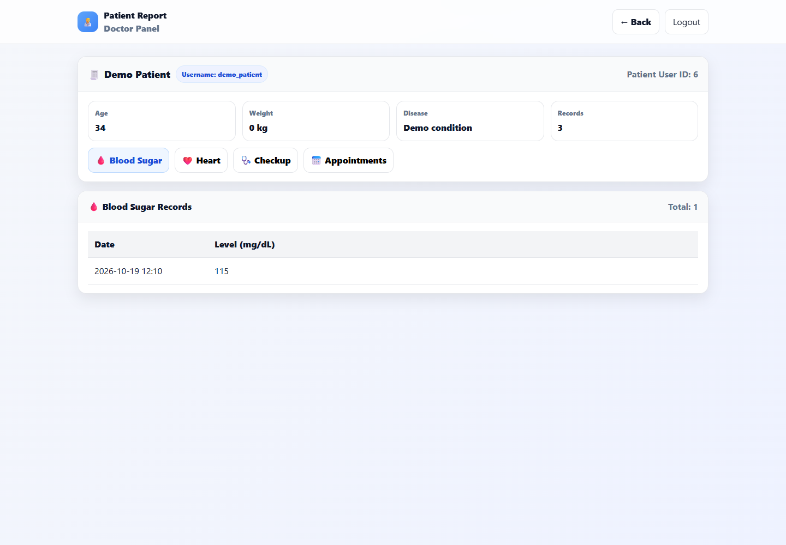 | 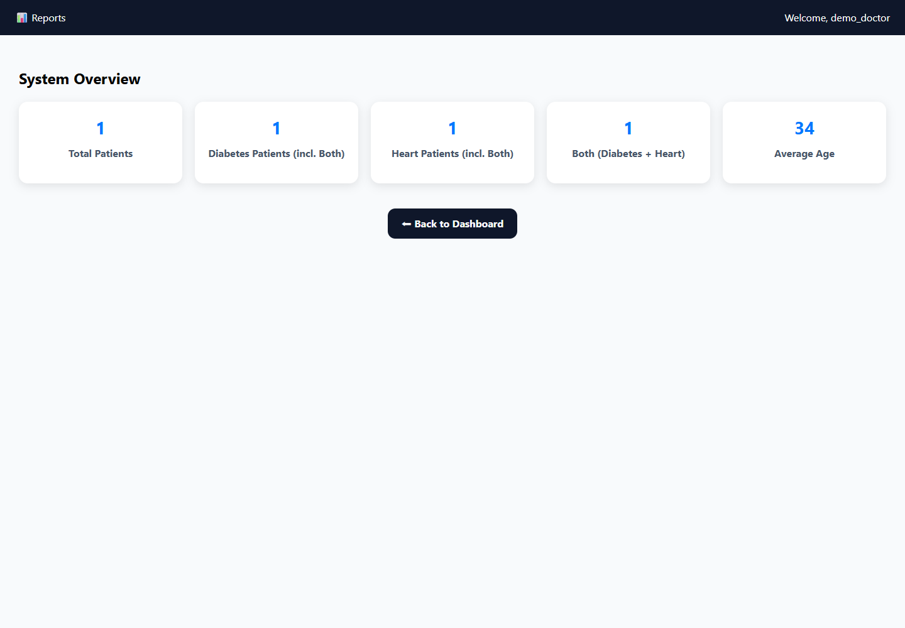 |

[Heart clinic](docs/screenshots/heart-clinic.png) · [Diabetes clinic](docs/screenshots/diabetes-clinic.png)

## Current boundaries

- Doctors share the patient directory; there is no per-doctor assignment model.
- Appointments are personal records, not booking requests sent to an external provider.
- Account recovery, email verification, and automated notifications are not implemented.
- Health records link to usernames; account/profile tables remain duplicated for compatibility. Username changes are not supported.
- Sessions and account rate limits are process-local. Multiple server instances require shared session storage and coordinated rate limiting.
- Formula-based nutrition and reading feedback are preserved; no clinical algorithms or thresholds were changed in this maintenance branch.
- Existing profiles with a missing/default date of birth need an administrator to correct their profile before nutrition estimates can be calculated.

## Repository hygiene

`.gitignore` excludes Visual Studio state (`.vs`, `*.user`), build/test outputs (`bin`, `obj`, `TestResults`), logs, local configuration, credentials/certificates, and database files. Generated files previously tracked in Git have been removed from the index without deleting source or migrations. Removing them from the current tree does not erase earlier Git history.
